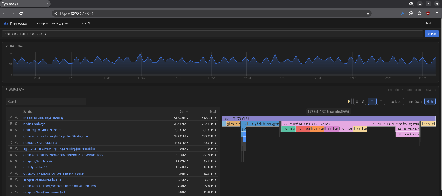

.. _profiling:

========================
Profiling with Pyroscope
========================

`Pyroscope <https://github.com/grafana/pyroscope>`_ is a continuous profiling platform designed to surface performance insights from applications.

Among other data it captures the following memory metrics:

.. list-table:: Memory metrics
    :header-rows: 1
    :widths: auto

    * - Name
      - Unit
      - Range
      - Description
    * - ``alloc_objects``
      - count
      - since previous upload
      - Allocation events — every ``make``/``new`` that was heap-allocated
    * - ``alloc_space``
      - bytes
      - since previous upload
      - Bytes allocated, including everything later freed
    * - ``inuse_objects``
      - count
      - instantaneous
      - Objects still live (allocated and not yet freed/collected)
    * - ``inuse_space``
      - bytes
      - instantaneous
      - Bytes still live

.. note::

    * ``alloc_*`` measures churn, not retention. A service that allocates 2 GB/s and frees 2 GB/s has enormous ``alloc_space`` and no dangling data. High ``alloc_space`` predicts GC CPU cost, not memory growth.
    * ``inuse_*`` measures retention. This is the actual "how much memory is the program holding" number.

Configuring Pyroscope
---------------------

This section assumes that the Pyroscope server and the Pyroscope client (receptor) run on the same server.

Configuring the Pyroscope server
^^^^^^^^^^^^^^^^^^^^^^^^^^^^^^^^

.. code-block:: bash

    podman network create pyroscope-net
    podman run -d --name pyroscope --network pyroscope-net -p 4040:4040 grafana/pyroscope:latest

The Pyroscope server is then accessible on port ``4040`` of the server.

Configuring the Pyroscope client
^^^^^^^^^^^^^^^^^^^^^^^^^^^^^^^^

Add the following block to the receptor configuration file:

.. code-block:: yaml

    - pyroscope-client:
        applicationName: receptor
        serverAddress: http://host.containers.internal:4040
        disableGCRuns: false
        uploadRate: "15s"
        tags:
          env: prod
        profileTypes:
          - ProfileGoroutines

Assuming receptor is running inside a container, restart receptor for the configuration to take effect:

.. code-block:: bash

    podman restart receptor

Receptor will start sending profile metrics to ``http://host.containers.internal:4040``. The host name ``host.containers.internal`` is the equivalent of ``localhost`` for containers run with podman.

See :doc:`configuration_options` for the full list of Pyroscope client configuration options.

Using Pyroscope
---------------

Once receptor is sending metrics to the Pyroscope server, browse to:

.. code-block:: text

    http://<hostname>:4040

The Pyroscope UI looks like this:

The metrics that are relevant for an environment with high memory consumption are **inuse_objects** and **inuse_space** for the **receptor** service.

Notice how the **flame graph** (right) shows how much memory has been consumed by the different functions of the receptor binary.

Look for functions whose names start with ``github.com/ansible/receptor``.

Click on the function names, then on **Expand all groups**, to explore which parts of the code are consuming memory.
